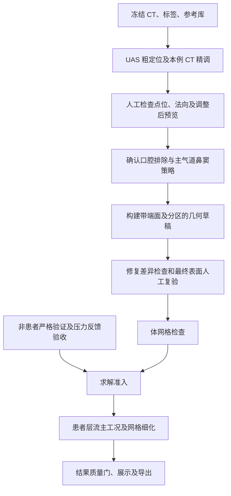

# 粗标定接入后的具体执行方法

更新时间：2026-10-03（北京时间）

本文设计从当前候选到首个患者 CFD 的具体做法。下面明确区分已有能力和待开发接口；新增文件名、状态、阈值及接口均为实施规格，尚未实现或验收。它与 [项目主线与实施计划](项目主线与实施计划.md) 和 [粗定位预设方案](09_coarse_localization/粗定位预设方案.md) 配套使用。

## 1. 先固定本轮交付边界

首轮只做一例 p0 的主鼻腔气道：双侧鼻孔为入口，鼻咽为出口，口腔排除，鼻窦不纳入主计算域。鼻窦保留作为单独的后续敏感性分支，不能在主版本里一边保留、一边用未确认的窦口连通性解释结果。

首例完成以下产物后才算闭环：

1. 当前 CT、六类标签、粗标定参考库和代码版本的输入身份记录；
2. 粗定位和本例 CT 精调候选；
3. 人工逐点审核记录；
4. 经过口腔排除和鼻窦策略明确确认的几何审核记录；
5. 带 `nostril_L`、`nostril_R`、`nasopharynx`、`wall` 分区的最终表面；
6. 通过几何和体网格质量门的求解 case；
7. 层流 15 L/min 主工况、网格细化对照、质量检查和结果报告。

只有通过完整质量门的算例才发布为正式患者结果；中间场可作为失败诊断保留。

| 环节 | 当前已实现 | 本轮还要补齐 |
|---|---|---|
| 导入与候选 | CT 检查、CPU 分割、QC、粗/精定位、审核页 | 已有 p0 纳入统一病例运行器，保持原病例身份和患者分组 |
| 候选版本 | 上传病例可保留旧版、快照参考库并生成新版 | 初次候选也固定库快照；新上传补匿名患者分组；按内容决定下游失效 |
| 人工审核 | 决定保存、来源校验、标点确认件 | 调整后 CT/平面预览、独立边界审核、最终表面复验 |
| 几何 | provisional 主空气掩膜、LPS 仿射表面提取 | 主气道范围审核、裁剪面分区、端面、修复差异和最终门禁 |
| 求解 | 合成算例、表面到 case、求解执行、指标提取 | 严格圆管通过、共同静压反馈、患者首例接入 |



## 2. 病例目录和身份

新上传病例继续放在 `C:/ts_work/project_cases/<case>/`。计算中间目录使用英文路径。新版候选已经使用 `public/versions/<revision>/` 和 `runs/<revision>/`；首次上传的旧布局仍兼容，不因整理目录覆盖它。

首例 p0 的 CT 和六类标签来自 `C:/ts_work/p0/`。新增病例登记接口引用这份既有数据或建立可追溯副本，固定 `case_id=p0`、`patient_id=p0`；无需重新上传、重新推理。病例管理器当前只接受 `u_<16位十六进制>`，接入 p0 时需要显式扩展受控登记，不能伪造上传编号来绕过同患者排除。

拟新增的审核及几何目录如下；候选目录继续沿用当前版本体系：

```text
<case>/
  ct.nii.gz
  masks/{nasal_cavity_left,nasal_cavity_right,nasopharynx,
         oropharynx,hard_palate,soft_palate}.nii.gz
  qc/gate_<case>.json
  public/versions/<revision>/review/
  public/versions/<revision>/preview/
  runs/<revision>/reference_library.json
  runs/<revision>/review_decisions.json
  runs/<revision>/review_config_confirmed.json
  runs/<revision>/boundary_review.json
  runs/<revision>/draft_previews/<draft_id>/
  geometry/<geometry_id>/{domain.nii.gz,raw.vtp,final.vtp,final.stl,
                         patch_map.json,manifest.json,quality_report.json}
  geometry/<geometry_id>/final_geometry_review.json
  geometry/<geometry_id>/contract_review_record.json
  solver/<run_id>/{config.json,case/,metrics/,logs/}
```

新增匿名 `patient_id` 和病例来源映射：p3/p3t1 同组；上传同人的另一个时点必须指定同组。未提供分组时显示“同患者排除信息不足”，不能声称已经排除了所有本人时点。病例编号和 CT 文件哈希只能排除其能识别的重复。

`case.json` 登记当前 revision；候选的 `receipt.json` 与 `input_provenance` 已用于内容校验。后续按依赖分层：候选依赖 CT/六类标签/库快照/定位代码，几何依赖 CT/选用标签/最终审核点及边界策略/几何参数，网格依赖最终表面/网格参数，求解依赖网格/边界工况/求解代码。输出目录使用新版本，成功验证后再原子切换当前指针；失败保留上一版本和失败日志。

参考库更新先生成新的候选审核版本。它不改变已经生成的表面字节；已有完成的历史结果继续可追溯。是否对当前病例重建几何，取决于新版本是否实际改变最终审核边界或几何输入，不能只因页面重新排版重跑求解。

## 3. 自动候选：粗定位先行，影像证据为准

### 3.1 运行和缓存

已有病例继续使用六类标签；新 CT 才调用预训练分割。先校验标签与 CT 的 size、spacing、origin、direction、有限值和必要标签非空。QC 的数据完整性失败即停止；触边、左右体积差和连通性属于复核证据，不能当作解剖正确的证明。

每次候选运行固定参考库快照后运行 `run_auto_anatomy.py`。默认正式库是 `work/06_auto_landmarks/reference_library.json`。以下命令是当前批处理入口示例，会更新现有候选；验证新算法应指定独立 `--out-base`、`--qc-base`，正式更新需形成新审核版本。本轮只设计方法，不执行重算。

```powershell
$taskPython = 'C:\Users\lenovo\.workbuddy\binaries\python\envs\nasal-cfd\Scripts\python.exe'
& $taskPython -X utf8 work/lib/run_auto_anatomy.py `
  --cases p0 `
  --data-base C:/ts_work `
  --out-base work/06_auto_landmarks `
  --reference-library work/06_auto_landmarks/reference_library.json
```

生成后先检查：

- `coarse_localization.json` 的参考库哈希与本次运行快照一致（后续全局库更新不改历史快照）；
- p0 的目标 descriptor 适用性为 true；
- 粗点只在 `search_prior` 时用于局部搜索；`display_only` 只显示，不缩小搜索范围；
- `landmarks.json` 的 `point_lps_mm` 始终来自 p0 CT 影像证据；
- `coarse_adjustment.json` 同时有粗点、精调点、UAS、UAS-NORM 和偏移；
- `clinical_validation` 仍为 `not_validated`。

固定现有初始粗定位条件：鼻腔范围采用 0.5%/99.5% 分位边界，三轴比例 0.7–1.4，局部框每轴半宽为 10 mm 加参考最大偏差，至少两位独立参考患者，偏差向量长度不超过 12 mm，目标硬腭拟合 RMS 不超过 1.5 mm。鼻腔/硬腭/鼻咽触边时停用；出口还需本例及参考的软腭/口咽不触边。这些是工程预设，不作统计置信区间。

当前 p2 可作为人工接受的粗定位参考并保留警告；p2 自身作为目标仍不满足粗定位条件。UAS-NORM 存储归一化比例，搜索框或位于鼻腔范围外的参考点可超出 0–1，不能强行截到范围内。尺寸变换仅作用于参考点及搜索框。

### 3.2 复核优先级

先处理影响几何边界的三个点，再处理定位参考：

1. `nostril_L`、`nostril_R`：检查是否符合约定的入口裁剪层面、是否保留鼻前庭及后方通道，结合鼻翼缘和外界空气识别；空气射线本身不能确认鼻孔边缘；
2. `nasopharynx_outlet`：检查是否位于鼻咽出口层面，不能仅凭软腭标签界面接受；
3. `posterior_choana_L`、`posterior_choana_R`：只作后鼻孔定位参考，不作为出口裁剪平面；
4. 查看三阈值漂移、平面残差、竞争面和粗搜索框外提示。

鼻孔的局部粗搜索失败时，接受全域回退结果的前提是回到三向切片确认；回退不是失败豁免。出口、后鼻孔超出粗框时，记录结构差异并优先复核，不自动把粗点替换成精调点。

## 4. 人工审核：先保存决定，再生成确认件

### 4.1 每个点的决定

审核人在当前病例 CT 的三向切片上逐点选择 `accept`、`reject` 或 `adjust`。先显示 CT 和分割叠加，再分别检查点位、法向与保留方向。操作可输入 LPS/mm 坐标；后续补 CT 点选/三维拖动，统一由服务端转换为 LPS。法向为三个有限数、长度非零，归一化须显式记录，不能默默修正输入。

调整后新增只读预览接口：以当前候选版本、草稿点/法向/ROI/保留方向生成 `draft_id`，输出穿过新点的三向 CT 切片、平面交线及三维裁剪草稿。显示原版和草稿版，预览哈希绑定完整草稿；修改任一参数就使上次预览失效。显示用体数据即使做降采样，审核位置必须映射回原 CT 物理空间。当前静态候选图片和审核坐标输入还不能完成这一步。

至少要写清以下观察：

- 鼻孔平面是否处在外界空气与鼻腔主通道的过渡处；
- 鼻咽出口是否有软腭、口咽或截断提示；
- 左右后鼻孔是否支持当前姿态和方向；
- 粗点到精点的偏移是否落在可解释的局部结构内；
- 任何“略深”“偏后”“偏上”的文字意见对应到哪一组切片和哪一个候选。

网页导出的 `review_decisions.json` 只记录决定。它必须经过来源哈希、病例、原坐标、proposal 哈希和单位校验，不能直接改写 `landmarks.json`。

### 4.2 生成正式解剖确认件

这里分为两次确认，先确认“怎么裁”，再确认“裁出的最终表面”。当前 `confirm_landmark_review.py` 能校验点位决定并生成 `review_config_confirmed.json`；没有最终几何时，其生成的契约记录必须继续锁定。

```powershell
& $taskPython -X utf8 work/lib/confirm_landmark_review.py `
  --decisions '实际审核记录路径/review_decisions.json' `
  --proposals-html '该审核版本路径/review/index.html' `
  --case p0 `
  --out-dir '独立点位确认输出目录'
```

命令中的路径为待替换占位，并不是已有文件。上传版本必须显式提供对应 `--proposals-html`，否则工具默认读取旧五例页面。第一步不传 `--geometry`、`--confirm-*`；工具退出成功只证明转换完成，不代表几何或求解就绪。

新增 `boundary_review.json` 独立记录建模判断，不能把两个 CLI 布尔标志当作证据：

| 项 | 必需内容 |
|---|---|
| 口腔排除 | 接受当前出口同时隔离口腔，或另设屏障；点/法向/ROI/保留侧；CT 证据；审核人和时间 |
| 鼻窦策略 | `exclude_sinuses`；实际排除掩膜/局部切面及哈希；在 CT 检查主气道是否被误删、是否仍有窦腔纳入 |
| 入口/出口 | 三个平面已审核、各自开口区域、保留侧和对应草稿预览身份 |
| 来源 | case/patient/revision、CT/标签哈希、点位确认件哈希、审核人和时间 |

鼻咽出口与口腔屏障可能使用同一物理平面：允许显式引用同一边界，分别记录“位置”和“口腔是否隔开”两个判断，不能当成两份独立定位证据。若需要额外口腔屏障，它是 wall，不是新增出口。

构建并修复表面后，审核最终 CT 叠加、开口分区、修复差异及几何质量报告，生成 `final_geometry_review.json`。由待开发的适配层将它转换为现有契约接受的记录形状，验证：

- `case`、`source_sha256`、proposal 哈希与当前 revision 一致；
- `confirmed_boundaries` 包含两侧鼻孔和鼻咽出口；
- `oral_exclusion_confirmed=true`；
- `sinus_boundary_policy_confirmed=true`；
- `reviewed_geometry_sha256` 与真正送入 `surface_to_case.py` 的最终分区表面字节哈希完全相同；审核同时绑定 patch 表、建模策略和质量报告；
- 审核人、时间、记录文件路径齐全。

任一点/法向/保留侧/边界策略改变，都生成新的草稿和几何身份，旧最终表面审核不能继承。若只是参考库换版且最终几何输入完全一致，仍须明确新版本关联，不能伪造历史审核。

## 5. 从确认件生成主气道几何

### 5.1 先生成体素域

主版本草稿从 `nasal_cavity_left | nasal_cavity_right | nasopharynx` 与 CT `<-300 HU` 的交集开始，保留 T350/T400 的结构对照。语义标签只负责限制解剖范围；它漏掉的鼻前庭/狭缝不会由粗点补出，遇到真实 CT 与标签不符时先修正分割并形成新标签版本。

```powershell
& $taskPython -X utf8 work/lib/anatomy_barrier_seg.py p0 `
  --data-dir C:/ts_work/p0 `
  --out-dir '独立几何草稿目录' `
  --review '独立点位确认输出目录/review_config_confirmed.json'
```

此命令只能生成待复核体素草稿。现有脚本有三个具体缺口，要在新几何构建器内解决：

1. 标点转换器只写五个标点平面，不写独立 `oral_exclusion`、`openings` 和完整 `review_checklist`；不能只传其输出就宣布口腔和开口检查完成。
2. 旧 `reviewed_candidate` 状态需要所有窦口已判断 open/closed，仍输出 provisional 命名；主版本排除鼻窦，不要求把未知窦口伪造为 closed。新门禁按主版本范围判断鼻窦是否确实排除，保留 unknown 窦口记录。
3. 旧裁剪是有限 ROI 内按体素中心裁剪，标签边缘可能已经封在 ROI 内，不能保证得到真实平面端面及语义分区。精确开口在表面层重建并验证。

具体体素做法：应用已确认的有限 ROI 屏障及鼻窦排除掩膜，保存每一步增删体素及 CT 叠加。验证左右鼻孔保留侧到鼻咽内部点的面连通路径，报告孤立分量。窄通道只有对角连通或分辨率不足时标记复核，不能用膨胀操作自动打通。保留前后掩膜、体积、局部截面积及屏障改变范围；原 CT/标签不覆盖。

体素裁剪草稿用于检查保留域，不用其阶梯端面冒充精确开口。表面构建时保留一份 `precut_air_mask`：应用口腔/鼻窦范围策略，三个数值入口/出口附近保留 CT 支持的裁剪前带状域，再在表面上精确切。原标签/CT 没有延伸到审核平面时停止修正分割，不凭空加一圈体素或延长管道使其相交。

### 5.2 表面生成和语义分区

首版不做全局减面或激进平滑。复用 `geo_manifest.make_surface_vtp` 的完整 LPS 仿射方法；不直接使用旧 `export_stl.py`，后者仅用 spacing/origin，没有完整处理 direction，也不写开口分区。各向异性扫描保留原 CT 审核；需要重采样时记录插值和变换，标签用最近邻，不能把插值后的细体素当作增加了扫描细节。

提取壁面后，在每个已确认局部平面与 ROI 内求交线，选择与相应通道相连的闭合轮廓，裁掉外侧并沿轮廓三角化端面；其他壁面原位保留。切面未形成闭合轮廓、同时穿过其他鼻道、出现竞争轮廓、开口面积为零时停下复核 ROI 和切面。端面顶点与壁面边界共享，定向一致；最终四个分区联合形成闭合流体外壳：

```text
nostril_L   inlet
nostril_R   inlet
nasopharynx outlet
wall         wall
```

单独的 wall 允许三个预期端面轮廓，联合 inlet/outlet/wall 后边界边必须为 0。数值端面是独立 patch，不能成为 wall。审核点 `nasopharynx_outlet` 显式映射为表面 patch `nasopharynx`；法向的裁剪保留方向与网格外法向分别存储，不能混用。

只自动移除重复/退化三角形，修复需要记录前后面数、体积、表面位移及关键截面变化。鼻窦排除人工封面标为 wall，并保存对应的排除审核。自交、未知洞和破坏主要细隙的修复回到人工复核。STL 输出为带命名 solids 的 ASCII，或 VTP 每面含字符串 `patch`；另附单位/哈希 manifest 和 patch_map。用户下载可提供独立 binary STL，但求解源仍绑定分区格式。

新增病例级 `build_patient_geometry.py`，实施接口拟为 `--case-root --proposal-revision --landmark-review --boundary-review --out-dir`。它统一完成：

1. 验证 CT、标签、候选、点位确认件及边界审核的来源；
2. 校验主气道掩膜与 CT 仿射；
3. 提取表面并建立四类 patch；
4. 输出 `geometry/manifest.json`、原始表面、修复表面和质量报告；
5. 草稿发布为可复核产物，另经最终表面审核及几何门禁后授予网格准入。脚本本身不生成 human confirmed 记录。

## 6. 几何门禁和体网格门禁

### 6.1 表面门禁

以下条件全部通过才允许进入 `surface_to_case.py`：

| 检查 | 要求 |
|---|---|
| 坐标和单位 | LPS，mm；转求解器前明确缩放到 m |
| patch 完整性 | 两入口、一出口、wall 全部存在，名称无重复 |
| 边界边 | 单独 wall 仅有预期端面轮廓；四类分区联合后边界边为 0 |
| 流体连通 | 两鼻孔到鼻咽均有连通路径 |
| 非流形/自交 | 非流形边和自交数为 0；检查不可用时保持待检查 |
| 体积和面积 | 正体积、各端面面积为正；修复差异全部报告并由最终几何审核接受 |
| 最小通道 | 鼻阀和主要鼻道未因重采样消失 |
| 来源绑定 | 几何 manifest 绑定 CT、标签、确认件和代码哈希 |

### 6.2 体网格门禁

`surface_to_case.py` 只负责生成 OpenFOAM case 骨架，不等于网格通过。每个网格等级都保存 `checkMesh` 输出、cell count、非正体积、concave cells、非正交度、skewness 和 patch 面数。

先以 medium 0.4 mm 背景、0.25 mm 初始局部目标生成网格；fine 为 0.275/0.20 mm，coarse 为 0.6/0.30 mm。沿用现有配置的六单元跨间隙规则：局部 h ≤ min(初始目标, 测得间隙/6)，检查实际网格通道而非只检查参数。CT 无法可靠分辨的亚体素间隙维持不确定性，不靠细网格制造准确性。

`locationInMesh` 从审核后主域内部点产生，以体素距离变换选远离壁面的正距离点，再验证三角面内外关系。进入 `snappyHexMesh` 前仅一次 mm→m 转换；生成器当前将 patch STL 写成 m，背景盒及内部点另由 mm 转换，后续不可再缩放已转换表面。

`checkMesh` 日志必须有实际通过结论、无 failed 检查，且项目追加要求无 concave cells、非正体积和丢失 patch。保存错误集合供三维定位。SST 后续加贴壁层，首层高度由实际 y+ 校核，不能只填写 y+≈1 目标就通过。

## 7. 患者首例 CFD 方法

### 7.1 先完成非患者求解器门禁

平行板算例保留为已验证的单位/场数据参考；患者表面链路还需圆管严格通过。目前圆管收集器只跑 0.4/0.2 mm 两档，粗档压降误差 <5%、细档 <2%、峰速误差 <5%、质量不平衡 <1e-6，并要求网格通过且细化误差下降。旧失败记录不覆盖；新三档要扩展收集器，不能声称已存在中档。

排查按受控实验执行：

1. 先用体贴圆管的合成结构网格核对 SI 单位、截面平均压力、phi 积分和 Poiseuille 理论；
2. 再用同一分区 STL 的 blockMesh→snappy 链，单独改变细化/贴合参数，消除 concave cells；
3. 使用充分发展入口剖面，记录实际网格端面积、周长、流量、压力测量面及长度；比较端到端压降与内段压力梯度，禁止把内段误差当成原端到端验收通过；
4. 独立保存 0.4/0.3/0.2 mm 三档和原两档检查，不反调放宽通过阈值；
5. 保存每档质量报告、日志、指标、网格及配置哈希，全部通过后验证共同入口压力适配器。

当前圆管 D=4 mm、Q=15 L/min 时 Re 约 5276。它是指定层流方程的数值对账，不能证明这个工况的物理层流稳定性。再加入低 Re 版本（如 Q=1 L/min，Re 约 352）检查解析层流；患者层流仅作为基线，模型适用性需结合本例几何和 SST 对照判断。

### 7.2 主工况

首例主工况采用不可压、稳态、刚性无滑移壁、层流：

- 双鼻孔使用同一个可调静压；
- 鼻咽出口静压为 0 Pa 表压；
- 外层压力迭代将总吸气流量调至 15 L/min；
- 左右流量由几何阻力自然产生；
- 不同时施加固定总流量和入口压力；
- 不把 50/50 分流作为患者结果。

新增 `patient_pressure_feedback.py`，先扩展 `surface_to_case.py` 对应的压力模式；原脚本现在按入口数量等分固定流量，无法直接满足自然分流。求解执行仍复用 `work/07_cfd_pipeline/solver/run_openfoam_case.py`，不新造一条求解器调用链。

每次内部求解：两鼻孔静压均为 P/rho（OpenFOAM 运动学压力），出口静压 0；速度采用该版本 OpenFOAM 兼容的压力入口/出口条件，wall 为零速度。禁止同时给 nostril 固定体积流量。实际边界字典先在合成支路中验收。

压力反馈以如下步骤实现，并保存全部迭代：

1. Q_target=2.5e-4 m³/s，从共同入口静压 1 Pa 开始；求解不收敛或网格不合格，不把其流量加入更新；
2. 对通过内部质量检查的运行积分 `phi`：Q_L=-sum(phi_L)、Q_R=-sum(phi_R)、Q_out=sum(phi_out)，方向必须为两入口流入、出口流出；不以 abs() 掩盖反流；
3. 根据 Q_total 相对目标增压或减压，通过加倍/减半的实测求解取得包围目标的压力区间；初始上限 200 Pa、总有效压力试算上限 30 次为新增工程保护参数，不能当作病理阈值；
4. 区间内采用割线更新；斜率不稳定、越界或无进展时使用二分。每轮只改共同入口压力，保持网格、出口、物性和离散设置不变；
5. 总流量误差 ≤1%，且内部残差、守恒和监视量均通过时停止。达到次数/压力界限、发生反流或不能形成区间时保持失败，不发布主工况；
6. 验收前冻结上述配置参数，若修改，记录新控制器版本及原因。

每轮产物放在 `solver/<run_id>/iterations/<n>/`，复用同一已验证网格，保存 P、Q_L、Q_R、Q_out、内残差、守恒、日志和哈希。合成验证至少包括对称支路、不同阻力支路、交换左右名称和无法达到目标的失败场景。低 Re 的独立平行支管按 R=8muL/(pi r⁴) 验证 Q_L/Q_R=R_R/R_L；合流分叉的附加损失另作数值对照，不套用独立支管公式。单纯得到 50/50 只能验证对称算例。

### 7.3 敏感性工况

主工况通过后再做：

1. 同一几何、同一层流目标流量的 coarse/medium/fine 三档；每档独立压力反馈至 15 L/min；
2. 若 T350/T400 改变关键通道、开口或体积，单独复核几何后再做敏感性；不能把三套阈值默认都当已审核；
3. k-ω SST 中网格，入口湍流强度 1%，必要时增加 5% 对照；验证贴壁层及实际 y+；
4. 独立静压差 18 Pa：nostril=0 Pa、nasopharynx=-18 Pa，取消流量控制，流量作为结果；
5. 录屏入口总压 0/出口静压 +18 Pa 的配置保留为独立复现，先验证方向，不能混成吸气 18 Pa 主方案。

层流结果的湍流强度字段必须是“不适用”；只有 SST 实际导出 `k` 或等价场后才报告湍流强度。

## 8. 结果提取和质量门

每个通过求解的 case 由现有求解器封装执行 `foamToVTK`，再调用 `work/lib/extract_cfd_metrics.py --case ... --out ...`。新增压力模式须补 functionObjects、原始有符号 phi 与提取器交叉核对，不能只依赖 VTK 端面速度插值。输出：

- 总流量、出口流量和质量不平衡；
- 静压、压力降和鼻阻力；
- 左右鼻孔流量及分流比例；
- 速度场、峰值速度、高速区域；
- 壁面剪切应力；若没有实际导出则填“未计算”；
- 层流/SST 模型和所有边界设置；
- solver log、网格报告、metrics JSON 和来源哈希。

沿用当前 `cfd_contract.py` 的患者工程检查初值，并将未实现的检查落实到实际数据：各方程目标残差 ≤1e-5、最后至少 100 步内压力/总流量监视量相对变化 ≤0.5%、质量不平衡 |Q_in-Q_out|/Q_in ≤0.5%，另加主工况总流量误差 ≤1%。近零监视量使用预先记录的绝对量容差；只打印 `End` 或达到最大迭代不算收敛。

medium→fine 的压降、同一定义峰速相对变化 <5%，左右分流份额差 <0.05（5 个百分点）。左右流量非近零时也报告相对变化；这些是预设工程筛查，失败时加密或保留“未完成网格稳定性”，不能悄悄改线。三档均记录，粗档可用于趋势分析，不代替中细比较。所有网格比较都保持最终几何及测量平面一致。

鼻阻力 R=Delta p/Q，主报告同时给 Pa·s/m³ 和 Pa·s/mL（除 1e6）。入口压力使用两鼻孔端面按面积加权的同一定义，出口相同。速度统计区域、峰值位置、显示插值方式固定。壁面剪切应力须实际导出并验证单位；分区鼻道流量未实现时维持 not_computed，不能以体积比例估计。

场数组长度、有限值、位置/关联、单位及几何哈希通过 `validate_result` 和数组实体校验。结果页只使用本例实际 VTK 场，标出输入、几何、网格、工况和结果质量状态；支持模型/STL、网格及配置日志、指标和基础报告导出。

## 9. 实施顺序

### P0：先交付两个可验收工程包

1. **审核到几何包**：p0 登记 → 可编辑平面及新预览 → 独立边界审核 → `build_patient_geometry.py` → 最终表面复验 → 几何门禁。先用合成病例验证新点改变切片与端面，法向/保留侧改变裁剪结果，三端面保留、哈希失配拒绝、失败版本不切换；再用 p0 形成真实草稿待复核。
2. **求解组件包**：圆管受控诊断 → 严格网格与压降通过 → 共同压力模式 → 低 Re 双支路自然分流验证 → 失败停止和重放验证。该包可在等待解剖审核时推进，患者结果不计入。

每包扩展病例运行器的真实产物索引、来源和失败原因，禁止先把状态改成 done 再等待产物。工作台继续按当前六个入口分组，各子阶段由真实状态展开，不再靠改导航名表示完成。

### P1：p0 首例

1. 完成 p0 五点决定，分别确认三处切面、保留侧、口腔排除和主版本鼻窦范围；
2. 生成 `G_main` 及分区表面，完成最终表面人工复验和哈希绑定；
3. 验证严格求解组件及压力模式报告，通过中等级 `checkMesh` 与局部通道检查；
4. 跑层流 15 L/min 主工况；
5. 跑 coarse/fine，并比较压降、峰值速度、左右分流和守恒，失败则继续加密或待处理；
6. 若层流基线及稳定性通过，发布标明模型假设的基线报告，再按需要跑 SST 1% 敏感性；
7. 实际完成的工况各自发布，未运行的 SST、阈值/18 Pa 对照显示未计算。

### P2：其余病例

建议顺序 p3（t2）、p1、p2、p3t1；每例有自己的 revision、审核和几何，复用同一契约和验收方法。p3 的两个时点统计上仍归为同一患者。病例层厚、姿态、病变/术后差异分开记录；不能因首例通过自动接受其他患者。

## 10. 每个阶段的停止条件

| 阶段 | 允许继续的条件 | 必须停止的条件 |
|---|---|---|
| CT 导入 | 序列连续、HU、仿射有效 | 缺片、方向冲突、强度非 HU |
| 分割/QC | 六类标签几何一致、数据质量门通过 | 空标签、CT/标签仿射不一致 |
| 粗定位/精调 | 粗定位失败可回退 CT 搜索；有真实候选时转人工审核 | 无 CT 候选且未人工补证据；把预计点填成精调 |
| 人工审核 | 决定、审核人、哈希齐全 | 只导出部分点或跨病例套用 |
| 几何 | 四类 patch、闭合外壳、连通、最终复验全部通过 | 端面丢失、自交/非流形、缺范围审核或几何哈希过期 |
| 网格 | checkMesh 和局部通道检查通过 | concave cells、patch 丢失、细隙消失 |
| 求解 | 收敛、守恒、边界方向和目标流量通过 | 混用压力/流量边界、残差假收敛 |
| 结果 | VTK、指标、哈希和报告齐全 | 用参考结果填患者场、缺场填 0 |

## 11. 最终审核包

每个患者 revision 最终打包：

```text
input_identity.json
qc/gate_<case>.json
coarse_localization.json
coarse_adjustment.json
landmarks.json
review_decisions.json
review_config_confirmed.json
boundary_review.json
final_geometry_review.json
contract_review_record.json
geometry/manifest.json
geometry/quality_report.json
mesh/mesh_quality.json
case/config.json
case/solver_manifest.json
metrics/metrics.json
results/result.json
logs/
```

报告首页明确写出：扫描版本、几何版本、主工况、是否通过网格和求解门禁、患者结果是否已计算、未计算字段及其原因。任何“准确率”“临床改善”“医学真值”都必须有独立标注数据和明确统计设计；当前版本不填写这些结论。

## 12. 单独验证粗标定的作用

粗标定目前只是搜索预设。为检验它是否减少找点和调整，评估时固定算法及工程参数，逐患者留出：同人的全部时点一并从参考库去掉，p3/p3t1 不能互为独立测试参考。目标 CT 相同哈希和病例编号也排除。现有人工接受的自动候选可以用于工程对照，不充当独立真值。

优先由两名复核人在不显示粗/精调点的 CT 上按统一口径标注入口、出口及后鼻孔点位/平面；分歧留存并讨论。只有一名复核人时做间隔重复标注，并明确无法评估观察者间差异。审核用于生产的决定与算法评估标注分别记录。

用相同 CT/标签对照“原本例影像搜索”和“粗先验+影像搜索”，均输出全部失败/回退，不只选择成功点：

| 指标 | 计算方法及解释 |
|---|---|
| 粗点误差 | LPS 欧氏距离到独立人工标点；按点类型、患者列出，中位数及范围 |
| 搜索框覆盖 | 独立人工点是否在该本例 UAS 框内；同时报适用例数和漏出点数 |
| 精调点误差 | 两算法分别到人工点距离，比较引入先验前后是否偏移 |
| 平面角度/位置 | 单位法向夹角及人工中心到候选平面的距离；法向符号/保留方向另行检查 |
| 回退/不可用 | 适用、仅显示、局部失败回退、无影像候选分开统计 |
| 人工工作量 | 实际找点时间、复核时间、调整次数/距离；算法计算时间另列 |

当前仅四位独立患者，先逐例展示；搜索框半宽或 RMS 等参数在这批评估中冻结。若依据这批结果调参，另留未来病例做检验，不能把调参病例上的改善当作独立验证。未设医学可接受误差线前不报告“准确率”。

## 13. 第一轮开发接口与验收任务

以下为拟新增接口，不是当前网页已支持的按钮或路由。沿用病例管理器、版本解析和私有/公开目录，不复制整个 pipeline。

| 实施项 | 输入 → 输出 | 单项通过条件 |
|---|---|---|
| 已有病例登记 | p0 现有 CT/六标签、原患者 ID → 病例状态及来源映射 | 不重推理，哈希一致，不能把 p0 本人当参考 |
| 草稿预览 | 候选 revision、点/法向/ROI/保留侧 → 新三切面、裁剪预览、草稿身份 | 调整确实改变预览，原图保留，旧预览不能确认新参数 |
| 边界审核 | 草稿身份、口腔屏障、鼻窦范围策略 → boundary_review | 缺任一范围判断保持待复核；改变掩膜会改变身份 |
| 几何构建 | 输入身份及两类审核 → 分区表面、patch_map、差异和质量报告 | 三端面、壁面闭合、LPS/mm、有限 ROI、反射仿射都验证 |
| 最终表面审核 | 表面/patch/质量报告哈希及实际人工决定 → 契约记录 | 只对被看的最终表面生效；不能从文件名推断非 provisional |
| 网格/结果准入 | 几何及工程验证报告 → 可执行配置及真实阶段状态 | 哈希失配、过期、失败网格和缺控制器验证全部拒绝 |

建议状态沿用现有八阶段：`candidates` 内登记粗/精定位子结果；`review` 完成只代表点位决定完备；`geometry=waiting` 等边界及最终表面审核；几何就绪后 `mesh=pending`；网格及工程组件通过后才排队 `solver`；场数据已有但结果门失败时 `results=failed` 并保留诊断。状态和输出成功原子发布，后台失败不把上一版标成新版。

第一增量到“p0 调整候选后有真实更新的 CT/裁剪草稿，能保存对应边界记录”为止；第二增量形成四分区、闭合外壳和最终表面复验；第三增量才接患者求解。执行者每次交付说明真实输入/输出、运行命令、验证证据和仍等待的人工决定，不把设计规格列为已实现功能。
